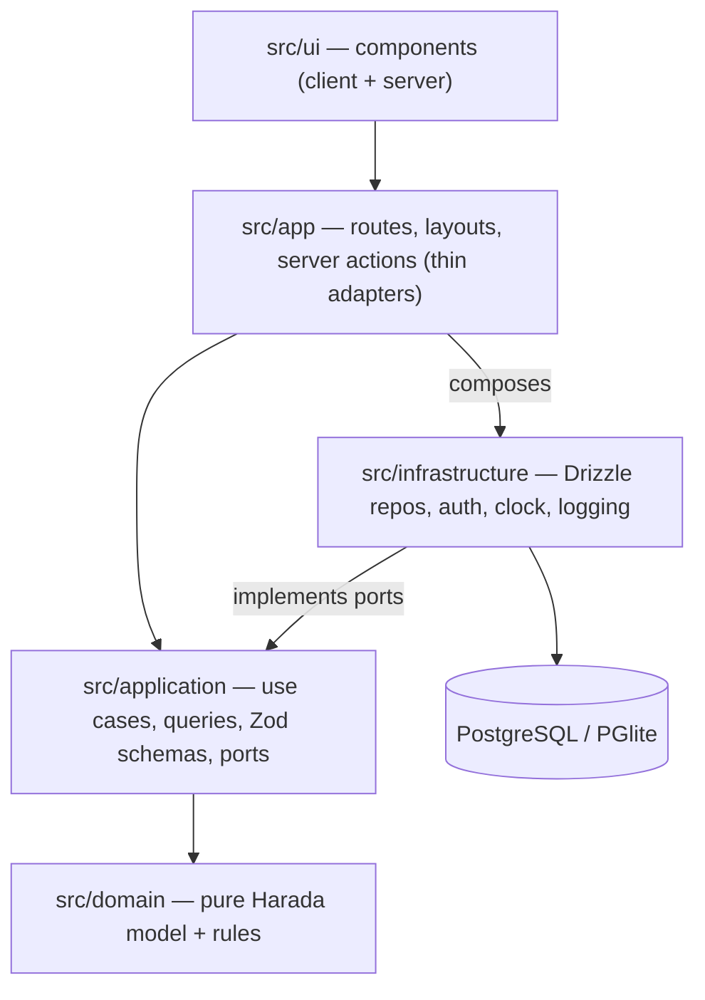

# Architecture — Harada Goal App

## 1. Overview

A server-rendered **Next.js 15 (App Router)** application in **strict TypeScript**, with a layered
("clean") architecture, **PostgreSQL** via **Drizzle ORM** (PGlite embedded Postgres for local dev
and tests), and session-based authentication.



## 2. Layers and rules

| Layer | Path | May import | Must not import |
|---|---|---|---|
| Domain | `src/domain/` | nothing but itself | React, Next, Zod, Drizzle, any I/O |
| Application | `src/application/` | domain, `zod` | infrastructure, Next, React, Drizzle |
| Infrastructure | `src/infrastructure/` | domain, application (ports/types), Drizzle, Node APIs | UI, React |
| Delivery | `src/app/` | everything (it's the composition root) | — business rules |
| UI | `src/ui/` | domain *types and pure formatters only*, application DTO types/schemas | infrastructure |

These are enforced by ESLint `no-restricted-imports` (see `eslint.config.mjs`).

**Business rules live only in `src/domain`.** Validation of input shape lives in
`src/application/schemas.ts`. UI components render DTOs and call server actions; they never compute
progress, enforce limits, or decide transitions (they may *display* hints such as "8 of 8" from DTO data).

## 3. Directory layout

```
src/
  domain/
    types.ts            canonical entity/value types (DOMAIN_MODEL.md)
    errors.ts           DomainError
    limits.ts           constants
    dates.ts            LocalDate arithmetic (pure, no Date-timezone pitfalls)
    goal.ts outcome.ts action.ts routine.ts reflection.ts   pure operations (validate + produce new state)
    progress.ts         progress, adherence, pace, streak
    next.ts             dueToday, nextActions
    templates.ts        example plans (plain data)
    *.test.ts
  application/
    result.ts           Result/AppError helpers
    ports.ts            repository + service interfaces (the contract with infrastructure)
    schemas.ts          Zod input schemas (shared with forms)
    dto.ts              DTO types + mappers
    context.ts          Ctx, Deps
    use-cases/          one file per area: auth.ts goals.ts outcomes.ts actions.ts reflections.ts
    queries/            today.ts goals.ts history.ts export.ts
    *.test.ts           integration tests against PGlite (via infrastructure test harness)
  infrastructure/
    db/schema.ts        Drizzle schema (DATABASE.md)
    db/client.ts        driver selection (postgres-js | PGlite), singleton, auto-migrate for PGlite
    db/repositories/    implementations of application ports
    auth/               password hashing (argon2id), session tokens, rate limiter
    clock.ts            system clock + time-zone → LocalDate
    logger.ts
    container.ts        builds Deps for the app (composition)
    testing/            createTestDeps(): fresh in-memory PGlite + migrations
  app/
    (auth)/signin, signup
    (app)/today, goals, goals/new, goals/[goalId]/{page,plan,routines,journal}, settings
    api/health, api/export
    actions/*.ts        'use server' adapters
    lib/session.ts      read cookie → getCurrentUser; requireUser()
  ui/
    primitives/         Button, Input, Textarea, Field, Dialog, Menu, Tabs, Progress, Badge, Toast, Skeleton, EmptyState
    features/           goal/, plan/, today/, routines/, journal/, settings/, auth/
    format.ts           percent/date formatting (pure display helpers)
drizzle/                generated SQL migrations
tests/e2e/              Playwright specs
docs/                   contracts and status
legacy/                 previous "Ascend" app (reference only; deleted when rebuild is complete)
```

## 4. Ports (application ↔ infrastructure contract)

Defined in `src/application/ports.ts`. Summary:

```ts
interface UnitOfWork { run<T>(fn: (r: Repos) => Promise<T>): Promise<T> } // single DB transaction
interface Repos {
  users: UserRepo; sessions: SessionRepo; goals: GoalRepo; outcomes: OutcomeRepo;
  actions: ActionRepo; checks: RoutineCheckRepo; reflections: ReflectionRepo; events: GoalEventRepo;
}
interface Deps {
  uow: UnitOfWork;           // transactional writes + consistent reads
  ids: () => string;
  passwords: PasswordHasher; // hash / verify
  tokens: SessionTokens;     // generate token, hash token
  rateLimiter: RateLimiter;
  logger: Logger;
}
```

Repositories return **domain entities** (not Drizzle rows). Every method that reads by id takes the
`ownerId`/`userId` and returns `null` if not owned.

## 5. Request flow (example: complete a task)

1. Client component calls server action `completeActionAction(actionId)` with `useTransition`.
2. Action: `const ctx = await requireCtx()` (session cookie → user → `{userId, now, today}`).
3. `completeAction(deps, ctx, { actionId })`:
   Zod parse → `uow.run`: load action + goal scoped by user → `domain.completeTask(action, now)` →
   `actions.update` → `events.append` → commit → map to `ActionDTO`.
4. Action returns `Result`; on success calls `revalidatePath` for affected routes.
5. Client shows success feedback, or the error message with retained form state.

## 6. Cross-cutting decisions

- **Time:** All "today" logic uses the user's IANA `timeZone` (stored on the user, detected at sign-up, editable in Settings). The domain only sees `LocalDate` strings.
- **Errors:** Typed `Result` everywhere across the app boundary. No stack traces or SQL errors reach the client.
- **Security:** Session auth (DB sessions, hashed tokens), Argon2id passwords, Next server-action Origin checks (CSRF), ownership scoping in every repo query, React escaping (no `dangerouslySetInnerHTML`), security headers in `next.config.ts`.
- **Rendering:** Pages are dynamic server components that call queries directly. Mutations are server actions plus `revalidatePath`. Optimistic UI only for idempotent toggles (routine check, task complete) where rollback is safe.
- **Observability:** Structured `logger` (JSON to stdout in production); `/api/health` checks the DB.

## 7. Change protocol for contracts

`DOMAIN_MODEL.md`, `API_CONTRACTS.md`, `DATABASE.md`, `DESIGN_SYSTEM.md`, `src/domain/types.ts`, and
`src/application/ports.ts` are **contracts**. To change one: describe the problem → propose the change
→ update the doc and `DECISIONS.md` → notify the orchestrator → migrate dependents. No silent divergence.
